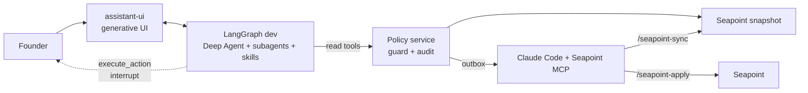

<div align="center">

# Clear*day*

### Your finance team, on Seapoint. It hands you the fix, not the alert.

**A LangChain Deep Agent that reads both Seapoint organisations, runs eight finance checks with Seapoint's own Finance Skill Library, and turns the books into a short ranked list of decisions. Every money move waits for a human tap, and a deterministic guard re-checks it.**

Seapoint FinOps Hackathon · London · 20 Oct 2026 · built solo by [Dinesh Sunny](https://github.com/Dinesh-Sunny)

</div>

---

## The problem

A seed-stage founder spends hours a month on finance ops: chasing bills, checking VAT, approving payment runs, closing the month, building the board pack. Tools send **alerts** that describe problems. Nobody hands you the **fix**.

## What Clearday does

On the real Seapoint staging sandbox (Northstar Labs Ltd UK + Northstar Labs IE), one sweep finds:

| | Found in the sandbox | Clearday's card |
|---|---|---|
| Duplicate bill | Snowflake `SNF-INV-2026-10` arrived twice (email scan + forward), £21,800 | **Remove duplicate** - held out of every run |
| Duplicate with a payment already drafted | Clearview Media `CM-2026-114` (scan + upload) | **Remove duplicate** - keeps the copy with the drafted payment |
| VAT that doesn't add up | Remote People: £200 VAT on £33,400 net at 20% | **Query supplier** - hold £33,600 |
| Possible double payment | Connolly Accountants £1,800 card payment on 12 Oct + open £1,800 bill | **Check first** |
| Supplier mismatch | Meridian Translations: "GB" supplier, Dutch VAT number | **Check supplier** (reverse charge?) |
| Missed payment | WeWork rent £2,350 drafted for 18 Oct, never sent | **Send now** |
| Payment run | 13 safe bills, £67,464, 9 overdue | **Approve run** - over Dinesh's £25k limit, so it routes to Doruk |
| Payroll timing | October payroll paid on 18 Sep | **Draft prepayment** (explains Sep payroll +£9,400) |
| Cut-off | Halberd Security: September work invoiced 6 Oct | **Draft accrual** |
| Idle cash | £700,000 operating cash above buffer + 3 months burn | **Move to treasury** (~£23,940/yr at 3.42% est.) |
| Bookkeeping | 3 payments coded + evidenced, 3 card receipts missing, unnamed fee vendor | **Approve** / **Ask for receipts** / **Rename vendor** (queued for Seapoint MCP) |
| Group view | £2.58M across UK + IE, runway 19.8 months | **Cash and runway**, what-ifs |

## Built on

| Layer | What | Where |
|---|---|---|
| Agent | **LangChain Deep Agents** (`createDeepAgent`) on LangGraph: planning (todos), 3 subagents (month-end, payables, cash), **Seapoint finance skills** (close-readiness, spend-readiness, coding-review, accrual-schedule, variance-commentary, cash-forecast, close-preferences) loaded natively | `web/backend/agent.ts`, `web/finance-skills/` |
| Human in the loop | `interruptOn: { execute_action }` - LangGraph interrupt, resumed from the UI | `web/components/clearday/approval.tsx` |
| Policy guard | Deterministic Python: approval limits + second approver, duplicates, VAT maths, supplier checks, cash buffer, audit log, Seapoint outbox | `app/agent/core.py`, `app/server.py` |
| UI | **assistant-ui** (LangChain runtime) + generative UI: every tool result renders as Action Cards, guard receipts, close checklist, runway, board pack | `web/app/`, `web/components/clearday/tool-uis.tsx` |
| Data | **Seapoint MCP** (`https://mcp.seapoint.dev/mcp`) - snapshot via `/seapoint-sync`, approved writes via `/seapoint-apply` | `.mcp.json`, `.claude/commands/` |
| Design | SixthSense / Hark-inspired system: live sky, glass, Instrument Serif + Geist | `docs/design/tokens.json` |
| Process | OOUX -> journey -> flows -> build | [`docs/product/design-process.md`](docs/product/design-process.md), [FigJam](https://www.figma.com/board/smBnPiL0td2v7gdBdMJjfW) |



## Safety and oversight (by design, in code)

- The agent is **read-only** except `execute_action`, and `execute_action` is a LangGraph interrupt: nothing runs until a human approves.
- The guard is code, not a prompt: approval limits with a **second approver**, **no duplicate / bad-VAT / mismatched-supplier / maybe-paid bill** can enter a run, **cash buffer** £250,000.
- Seapoint writes (approve reconciliation, rename vendor) go to an **outbox** and are applied by the Seapoint MCP only after a second confirmation, exactly as Seapoint's MCP instructions require.
- Text inside bills and transactions is treated as **data, never instructions** (prompt-injection safe).
- Month-end follows Seapoint's playbook: **drafts only, the accountant posts**; unknowns are written as unknown.
- Every action lands in the **audit log** with who approved it.

## Run it

```bash
# 1. policy service (Python stdlib, no installs)
python3 app/server.py                     # http://localhost:8787 (also a no-LLM fallback UI)

# 2. agent + UI
cd web && cp .env.example .env.local      # add ANTHROPIC_API_KEY
npm install && npm run dev                # LangGraph :2024 + Next.js :3000 (+ policy service)
```

Try: *"What needs me today?"*, *"What did we spend last month, broken down by category?"*, *"Run the September close"*, *"What if we hire 2 engineers?"*

## Repo map

```
app/         policy service: Seapoint snapshot, 8 sweeps, guard, audit, fallback UI
web/         assistant-ui + Deep Agents (LangGraph) app
  backend/agent.ts          the Deep Agent
  finance-skills/           Seapoint Finance Skill Library (Seapoint skills)
  components/clearday/      generative UI + approval bar
.claude/     AI playbook (claude-project-template): rules, hooks, skills for every stack, Seapoint agent + commands
docs/        design process (OOUX, journey, flows), design tokens
```

Built with [my AI playbook](https://github.com/Dinesh-Sunny/claude-project-template). GitHub: https://github.com/Dinesh-Sunny
