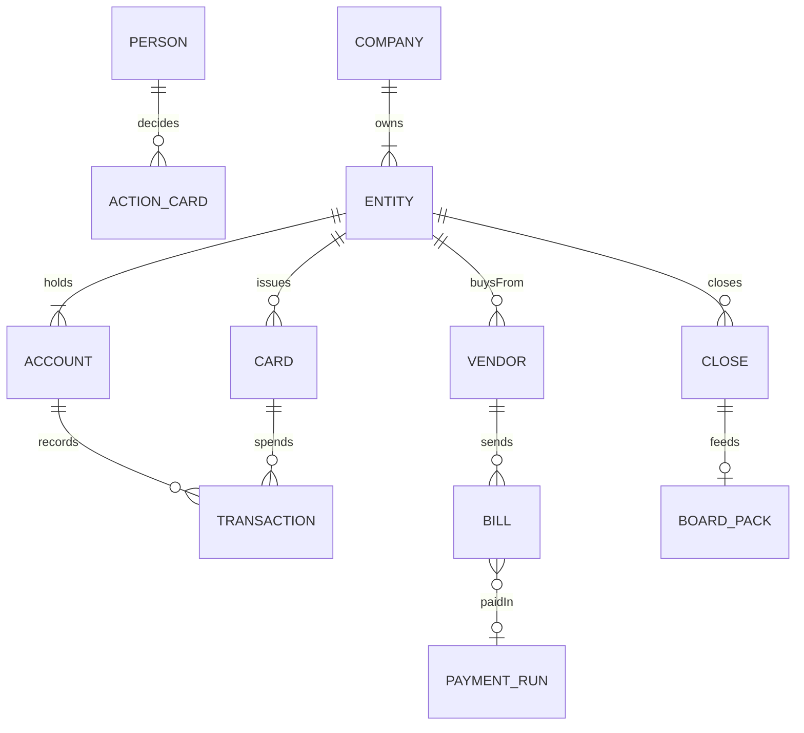
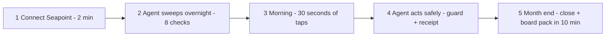
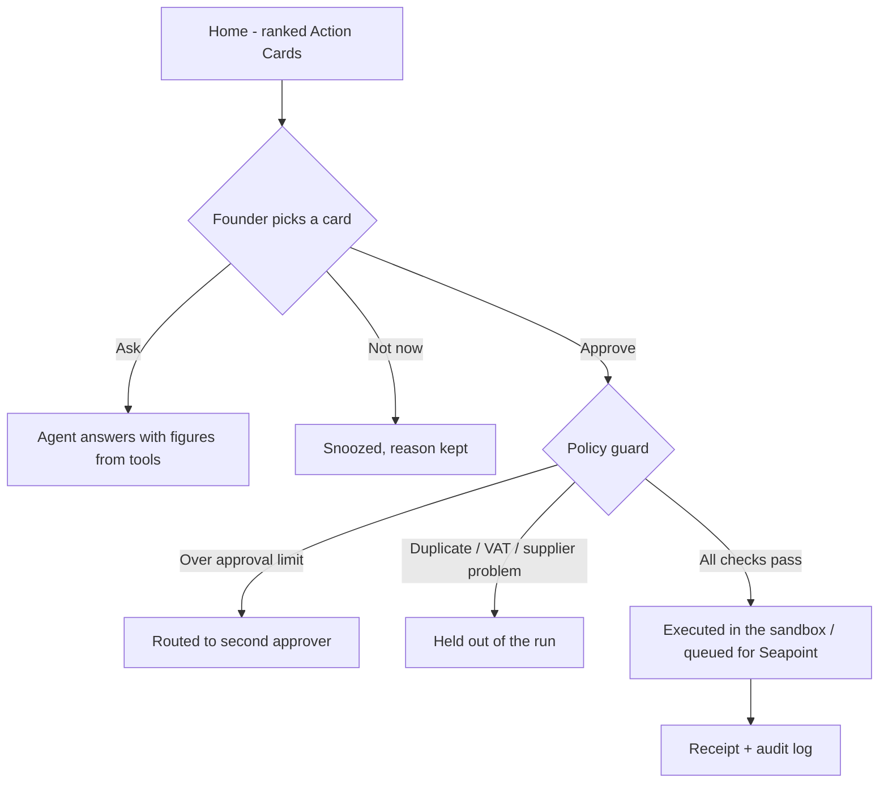

# Clearday design process

OOUX first, then the user journey, then the user flows, then the build. Live boards: [FigJam - OOUX, journey and core flow](https://www.figma.com/board/smBnPiL0td2v7gdBdMJjfW).

## 1. OOUX (objects, relationships, CTAs, attributes)

The eight problem groups on the night (month-end close, reconciliation and categorisation, AP / bills / spend, receivables and billing, cash / runway / forecasting, reporting and board packs, multi-entity and consolidation, bring your own) all sit on one object model. Every object maps to a Seapoint MCP tool.

| Object | Key attributes | CTAs | Seapoint MCP |
|---|---|---|---|
| Person (founder, finance lead) | role, approval limit | approve, delegate | `get_current_user` |
| Company / Entity (UK, IE) | currency, FX, cash | consolidate | `get_current_user`, `query_accounts` |
| Bank account / Treasury | balance, yield | reconcile, move to treasury | `query_accounts`, `query_treasury_returns` |
| Transaction | amount, category, coding, evidence, reconciliation | categorise, approve, match | `query_transactions`, `set_transaction_*`, `approve_reconciliation` |
| Card | holder, limit, spent | freeze, ask for receipt | `query_cards` |
| Vendor | name, category | rename, verify | `query_transaction_participants`, `update_vendor` |
| Bill (supplier invoice) | amount, VAT, due, source | pay, hold, remove duplicate | `query_invoices` |
| Payment / Payment run | status, scheduled date | approve run, send now | `query_payments` |
| Payroll run | period, pay date, net | draft prepayment | `query_payroll` |
| Month-end close | checklist | sign off | (skills: close-readiness, close-package) |
| Board pack | KPIs, variance, narrative | export | (skills: variance-commentary) |
| **Action Card** (the agent's proposal) | verb, reason, money at stake, risk, deadline, evidence, plan | **Approve, Not now, Why?** | - |

## 2. User journey (founder, one week)

## 3. Core user flow - Action Card to safe execution

## 4. Design system

SixthSense / Hark-inspired: soft sky atmosphere tied to the time of day, frosted glass pills, Instrument Serif display line, Geist text, Geist Mono for money, dark pill buttons, borders over shadows, and colour only for state (needs care / worth a look / routine). Tokens: [`docs/design/tokens.json`](../design/tokens.json). Copy follows "simple, precise, helpful, human": the real vendor, the real number, the verb that says what happens.
